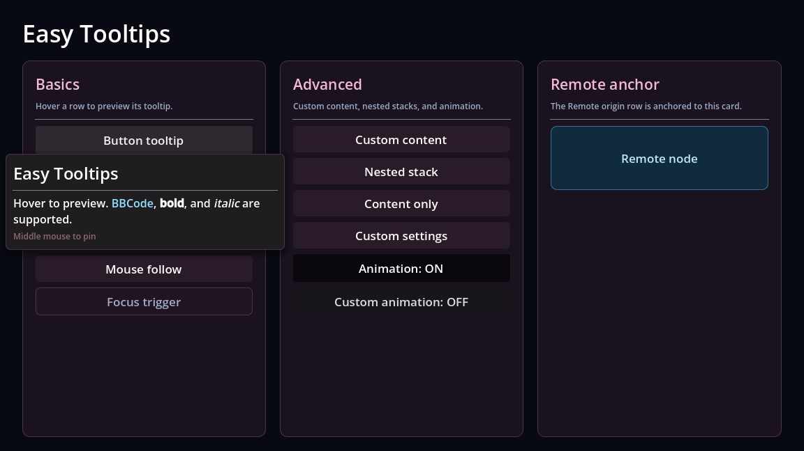
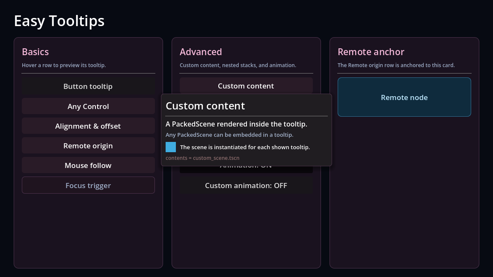
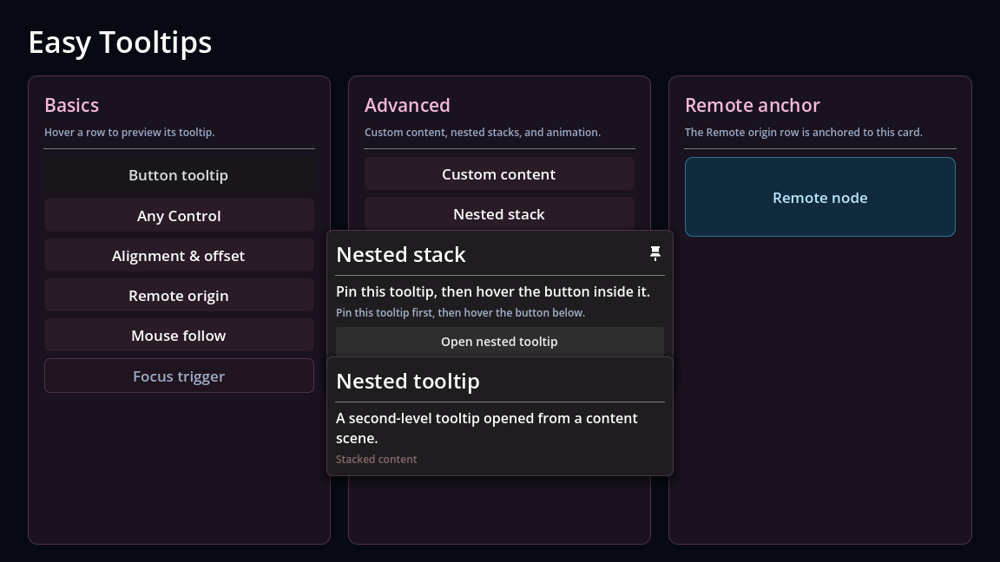

<div align="center">

# Easy Tooltips


· **English** · [简体中文](README_zh.md)

### A lightweight Tooltip system for Godot 4.7+
#### Attach a `TooltipTrigger` node under any Control node
#### to get a tooltip panel with title / body / footer / custom rich content
#### Supports 9-point alignment, screen overflow handling, mouse following, keyboard focus triggering, pinning, and content nesting






</div>

## Features

- **Separation of content and style**: `TooltipTrigger` handles content, while `TooltipTemplate` handles appearance. You can customize the template to change the look.
- **Easy configuration**: Global default settings + per-trigger overrides (`INHERIT`).
- **Robust display**: 9-point alignment, screen edge flipping / clamping, mouse following.
- **Trigger modes**: Mouse hover, keyboard focus, or both.
- **Content support**: Supports instantiating scenes as child content of the Tooltip.
- **Customizable animations**: Default open/close animations (fade in with scale / fade out with shrink) can be replaced via public methods in the global `EasyTooltips` script. Animations can be globally toggled using `enable_animation`.
- **High performance**: Panels are automatically destroyed when hidden, leaving no orphaned nodes.

## Directory Structure

```text
addons/easy_tooltips/
  plugin.cfg              # Plugin description and entry point
  plugin.gd
  classes/
    tooltip_enums.gd      # All enums
    tooltip_setting.gd    # TooltipSetting resource definition class
    tooltip_template.gd   # TooltipTemplate panel base class
    tooltip_animation.gd  # Built-in animations (fade_in / fade_out)
  scripts/
    easy_tooltips.gd      # EasyTooltips singleton: display, positioning, pinning, destruction
    tooltip_trigger.gd    # TooltipTrigger
  templates/
    tooltip_panel_standard.tscn  # Standard panel (includes PinIcon)
  examples/
    examples.tscn         # Example scene
    examples.gd           
    content/              
```

## Quick Start

1. Copy `addons/easy_tooltips/` to the `addons/` directory of your project.
2. Enable **Easy Tooltips** in "Project Settings → Plugins". The plugin will automatically add the `EasyTooltips` Autoload and the `easy_tooltips_pin` input action. If the editor does not load the Autoload/input action immediately, simply restart the editor.
3. Add a `TooltipTrigger` node under the host node (which must inherit from `Control`) to use it.
4. Fill in the properties in the Inspector or update them dynamically via code.
5. Run. The host defaults to the parent node, but can also be manually specified in the `host` property.

```gdscript
# Can also be created in code
var trigger := TooltipTrigger.new()
trigger.title = "Health Points"
trigger.content = "Current HP [color=red]42[/color] / 100"
trigger.footer = "Hold Shift for details"
trigger.origin = TooltipEnums.Origin.MOUSE_FOLLOW
button.add_child(trigger)
```

## Settings & Inheritance

`TooltipSetting` (`addons/easy_tooltips/resources/default.tres`) provides global default values.
When a field with the same name on `TooltipTrigger` is set to `INHERIT` (`-1`) or `null`, it falls back to the global setting:

| Field | Description |
| --- | --- |
| `tooltip_template` | Panel scene, root node must be `TooltipTemplate` |
| `trigger_mode` | `MOUSE` / `FOCUS` / `BOTH` |
| `alignment` | 9-point alignment |
| `origin` | `HOST` / `REMOTE` / `MOUSE` / `MOUSE_FOLLOW` |
| `overflow` | `FLIP` / `CLAMP` / `NONE` |
| `pin_mode` | `OFF` / `HOLD` / `TOGGLE` |
| `hover_delay` | Display delay (milliseconds) |
| `width` | Panel width (pixels, default 400; `<= 0` uses the template's own width) |
| `enable_animation` | Whether to enable open/close animations |

Default settings can be replaced at runtime:

```gdscript
EasyTooltips.set_default_setting(my_setting)
EasyTooltips.get_setting("hover_delay")          # Read global value
EasyTooltips.get_setting("alignment", trigger)   # Read the effective value on the trigger
```

## Animations

> Example of custom animation:

```gdscript
func _ready() -> void:
    var fade_in := func(tooltip: TooltipTemplate) -> Tween:
        tooltip.pivot_offset_ratio = Vector2(0.5, 0.5)
        tooltip.modulate.a = 0.0
        var tween := tooltip.create_tween()
        tween.tween_property(tooltip, "modulate:a", 1.0, 0.2)
        return tween
    EasyTooltips.set_open_animation(fade_in)
```

> **Tweening the panel's `position` / `global_position` is not recommended**: The manager recalculates the panel position every frame, which will override the animation. When a displacement effect is needed, please use Godot 4.7+'s `Control.offset_transform_*`.

## Custom Content

`TooltipTrigger.contents` is an `Array[PackedScene]`. Every time it is displayed, each scene is instantiated once and mounted under the template's `content_holder`; different Tooltips do not affect each other.

```gdscript
trigger.contents = [preload("res://path/to/your_content.tscn")]
```

In the editor, simply drag the `.tscn` file into the `contents` array.

## Custom Templates

Just ensure the root node is `TooltipTemplate`; everything else can be customized.

| Property | Required | Description |
| --- | --- | --- |
| `title_label` | Yes | Title `RichTextLabel` |
| `body_label` | No | Body `RichTextLabel` |
| `content_holder` | Yes | Parent container for custom content (its child nodes can only be interacted with after pinning) |
| `footer_label` | Yes | Footer `RichTextLabel` |
| `title_separator` | No | Title separator line, automatically hidden when the title is empty |
| `pin_icon` | No | Icon node displayed when pinned |

The panel will call `setup()` to populate text and content after being added to the scene tree. Subclasses can override `when_empty()` for additional processing:

```gdscript
extends TooltipTemplate

func when_empty() -> void:
    # Change title to accent color when there is no body, or hide extra decoration nodes
    if not content_holder.visible:
        title_label.add_theme_color_override("default_color", Color.GOLD)
```

Whether `title` / `content` / `footer` supports BBCode depends on the `RichTextLabel`. When the text on the trigger is empty, the default text in the template scene will be retained.

## Examples

The plugin provides an example scene. You can open `addons/easy_tooltips/examples/examples.tscn` and run it to see the effects.

## License

[MIT](LICENSE)

Copyright (c) 2026 Suzuran28