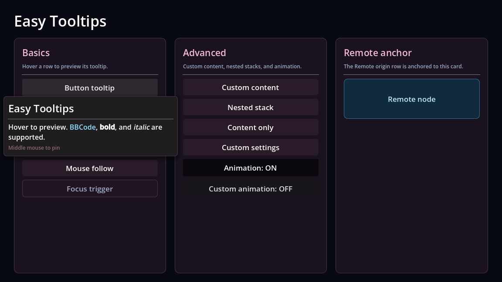
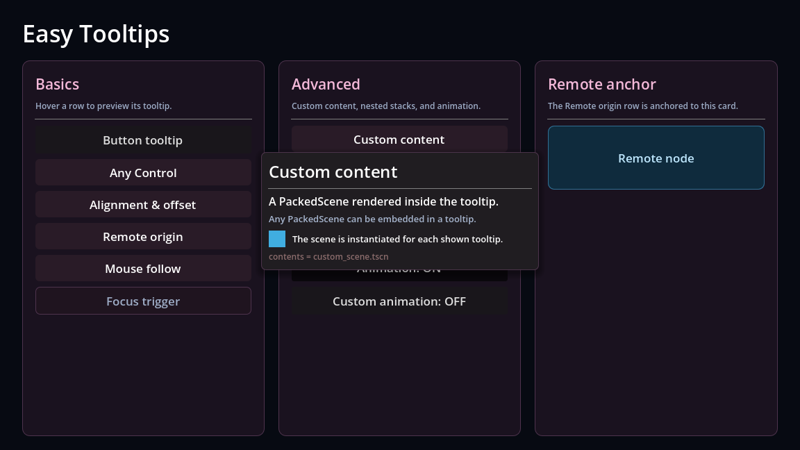
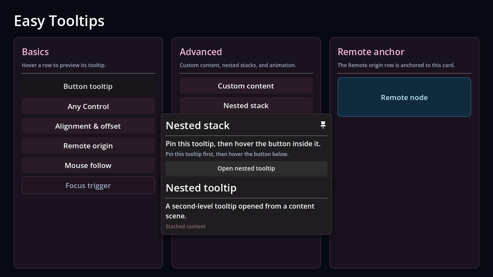

<div align="center">

# Easy Tooltips


·[English](README.md) · **简体中文**

### 一个面向 Godot 4.7+ 的轻量 Tooltip 系统
#### 在任意控件下挂一个 `TooltipTrigger` 节点
#### 即可获得带标题 / 正文 / 页脚 / 自定义富内容的提示面板
#### 支持九宫格定位、屏幕溢出处理、鼠标跟随、键盘焦点触发、钉住与内容嵌套






</div>

## 特性

- 内容与样式分离：`TooltipTrigger` 负责内容，`TooltipTemplate` 负责外观。你可以自定义模板来更改外观
- 设置方便：全局默认设置 + 单个触发器覆盖（`INHERIT`）
- 显示完善：九宫格对齐、屏幕边缘翻转 / 钳制、鼠标跟随
- 触发方式支持：鼠标悬停、键盘焦点或两者同时触发
- 内容支持：支持实例化场景为Tooltip的子内容
- 动画自定义：默认的打开/关闭动画（淡入缩放 / 淡出缩小），可通过全局脚本 EasyTooltips 的公开方法替换，可用 `enable_animation` 全局开关动画
- 高性能：面板在隐藏时自动销毁，不存在孤立节点

## 目录结构

```
addons/easy_tooltips/
  plugin.cfg              # 插件描述与入口
  plugin.gd
  classes/
    tooltip_enums.gd      # 全部枚举
    tooltip_setting.gd    # TooltipSetting 资源定义类
    tooltip_template.gd   # TooltipTemplate 面板基类
    tooltip_animation.gd  # 内置动画（fade_in / fade_out）
  scripts/
    easy_tooltips.gd      # EasyTooltips 单例：显示、定位、钉住、销毁
    tooltip_trigger.gd    # TooltipTrigger 触发器
  templates/
    tooltip_panel_standard.tscn  # 标准面板（含 PinIcon）
  examples/
    examples.tscn         # 示例场景
    examples.gd           
    content/              
```

## 快速开始

1. 把 `addons/easy_tooltips/` 复制到你的项目的 `addons/` 目录下
2. 在「项目设置 → 插件」中启用 **Easy Tooltips**。插件会自动补充
   `EasyTooltips` Autoload 和 `easy_tooltips_pin` 输入动作；如果编辑器没有立即加载
   Autoload/easy_tooltips_pin，重启一次编辑器即可
3. 在宿主(基类为Contorl)的节点下添加一个 TooltipTrigger 即可使用
4. 在 Inspector 里填写属性或代码中动态更新属性
5. 运行。宿主默认取父节点，也可以在 `host` 中手动指定

```gdscript
# 也可以在代码里创建
var trigger := TooltipTrigger.new()
trigger.title = "生命值"
trigger.content = "当前生命值 [color=red]42[/color] / 100"
trigger.footer = "按住 Shift 查看详情"
trigger.origin = TooltipEnums.Origin.MOUSE_FOLLOW
button.add_child(trigger)
```

## 设置与继承

`TooltipSetting`（`addons/easy_tooltips/resources/default.tres`）提供全局默认值。
`TooltipTrigger` 上同名字段的值为 `INHERIT`（`-1`）或 `null` 时回退到全局设置：

| 字段 | 说明 |
| --- | --- |
| `tooltip_template` | 面板场景，根节点必须是 `TooltipTemplate` |
| `trigger_mode` | `MOUSE` / `FOCUS` / `BOTH` |
| `alignment` | 九宫格对齐 |
| `origin` | `HOST` / `REMOTE` / `MOUSE` / `MOUSE_FOLLOW` |
| `overflow` | `FLIP` / `CLAMP` / `NONE` |
| `pin_mode` | `OFF` / `HOLD` / `TOGGLE` |
| `hover_delay` | 显示延迟（毫秒） |
| `width` | 面板宽度（像素，默认 400；`<= 0` 使用模板自身宽度） |
| `enable_animation` | 是否启用打开/关闭动画 |

运行时可替换默认设置：

```gdscript
EasyTooltips.set_default_setting(my_setting)
EasyTooltips.get_setting("hover_delay")          # 读取全局值
EasyTooltips.get_setting("alignment", trigger)   # 读取触发器上生效的值
```

## 动画

> 动画自定义样例如下

```gdscript
func _ready() -> void:
    var fade_in := func(tooltip: TooltipTemplate) -> Tween:
        tooltip.pivot_offset_ratio = Vector2(0.5, 0.5)
        tooltip.modulate.a = 0.0
        var tween := tooltip.create_tween()
        tween.tween_property(tooltip, "modulate:a", 1.0, 0.2)
        return tween
    EasyTooltips.set_open_animation(fade_in)
```

> **不建议 tween 面板的 `position` / `global_position`**：管理器每帧都会重新计算面板位置，会覆盖动画。需要位移效果时，请使用 Godot 4.7+ 的 `Control.offset_transform_*`

## 自定义内容

`TooltipTrigger.contents` 是 `Array[PackedScene]`。每次显示时，每个场景会被实例化一份并
挂载到模板的 `content_holder` 下；不同 Tooltip 之间互不影响。

```gdscript
trigger.contents = [preload("res://path/to/your_content.tscn")]
```

在编辑器里把 `.tscn` 拖进 `contents` 数组即可。

## 自定义模板

只需确保根节点为 `TooltipTemplate` ，其余均可自定义

| 属性 | 必需 | 说明 |
| --- | --- | --- |
| `title_label` | 是 | 标题 `RichTextLabel` |
| `body_label` | 否 | 正文 `RichTextLabel` |
| `content_holder` | 是 | 自定义内容的父容器（钉住后其子节点才可交互） |
| `footer_label` | 是 | 页脚 `RichTextLabel` |
| `title_separator` | 否 | 标题分隔线，标题为空时自动隐藏 |
| `pin_icon` | 否 | 钉住时显示的图标节点 |

面板会在加入场景树后调用 `setup()` 填充文本与内容，子类可以重写 `when_empty()` 做额外处理：

```gdscript
extends TooltipTemplate

func when_empty() -> void:
    # 没有正文时把标题改成强调色，或隐藏额外的装饰节点
    if not content_holder.visible:
        title_label.add_theme_color_override("default_color", Color.GOLD)
```

`title` / `content` / `footer` 是否支持 BBCode 取决于 `RichTextLabel` 。触发器上的文本为空时，会保留模板场景里自带的文本

## 示例

插件提供实例场景，可打开 `addons/easy_tooltips/examples/examples.tscn` 运行查看效果

## License

[MIT](license)

Copyright (c) 2026 Suzuran28